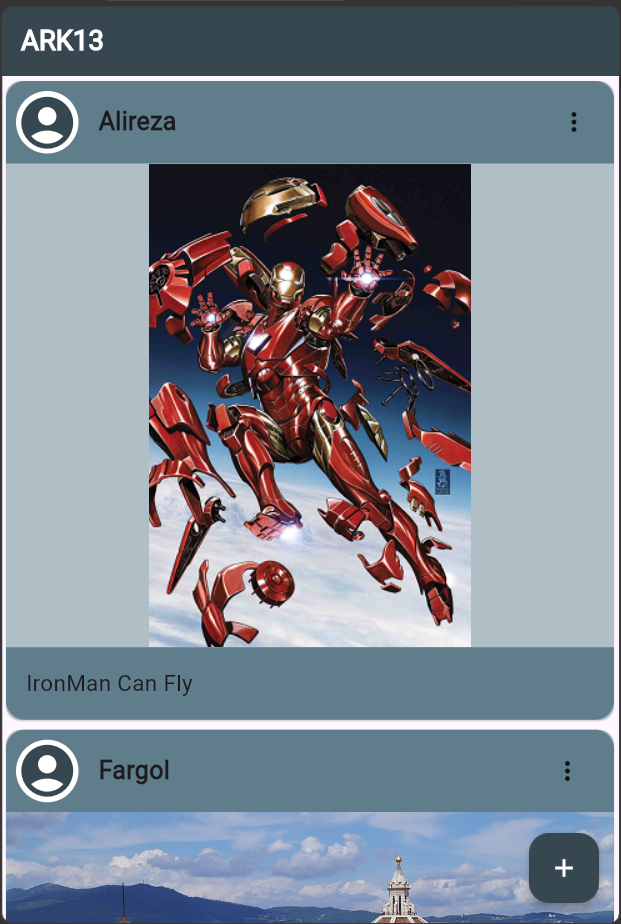
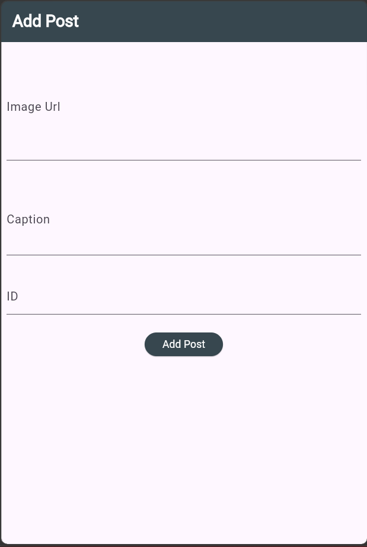
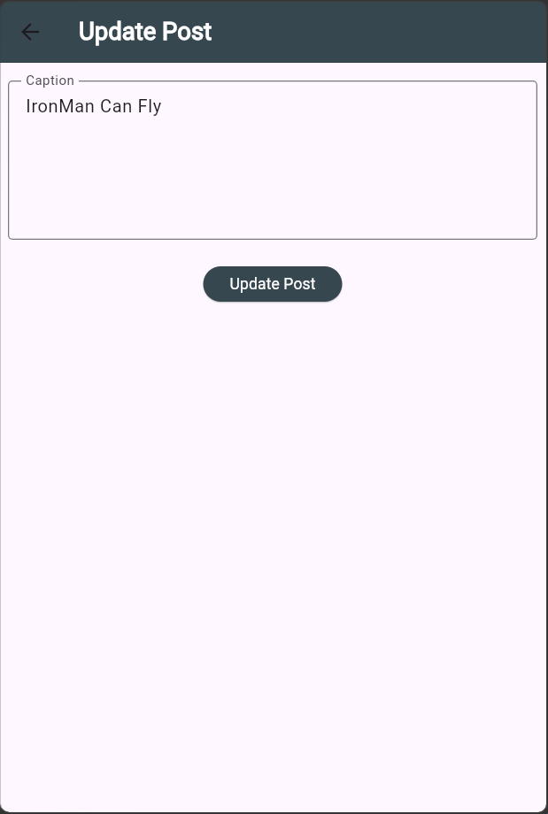

# Instagram Posts UI – Flutter

A simple Instagram-style Posts application built with **Flutter** and integrated with a custom **FastAPI backend**.

This project focuses on practicing Flutter UI development and connecting a mobile application to a REST API. It allows users to view posts, create new posts, update captions, and delete existing posts.

## 📱 Screenshots

### Posts Feed


### Add Post


### Update Post


## ✨ Features

- **View Posts:** Fetch and display posts from the FastAPI backend.
- **Post Information:** Display usernames, images, and captions.
- **Create Posts:** Add a post using an image URL, caption, and creator ID.
- **Update Captions:** Edit an existing post's caption.
- **Delete Posts:** Remove posts from the feed.
- **Pull to Refresh:** Refresh the posts feed to retrieve updated data.
- **API Integration:** Communicate with the backend using HTTP requests.
- **Navigation:** Navigate between the feed, add-post, and update-post screens.

## 🛠️ Tech Stack

| Technology | Purpose |
|---|---|
| Flutter | Mobile application development |
| Dart | Programming language |
| FastAPI | Backend REST API |
| HTTP package | API communication |
| JSON | Data exchange and serialization |
| SQLAlchemy | Backend database ORM |
| SQLite | Backend database |

## 📂 Project Structure

```text
lib/
│
├── api/
│   └── dart_api.dart
│
├── models/
│   └── post_model.dart
│
├── screens/
│   ├── add_post.dart
│   └── update_post.dart
│
└── main.dart
```

## 🔗 Backend Integration

This Flutter application uses a separate FastAPI backend for post operations.

**Backend Repository:**  
[FastAPI-Instagram-API](https://github.com/ARK13-org/FastAPI-Instagram-API)

The application communicates with the following API endpoints:

| Method | Endpoint | Description |
|---|---|---|
| GET | `/post/` | Retrieve all posts |
| GET | `/post/2` | Retrieve a post by ID (currently used by the API helper) |
| POST | `/post/create_post` | Create a new post |
| PATCH | `/post/update_caption/{id}` | Update a post caption |
| DELETE | `/post/delete_post/{id}` | Delete a post |

## ⚙️ Installation and Setup

### 1. Clone the Repository

```bash
git clone https://github.com/ARK13-org/instagram-posts-flutter.git
```

### 2. Navigate to the Project

```bash
cd instagram-posts-flutter
```

### 3. Install Dependencies

```bash
flutter pub get
```

### 4. Configure the Backend Address

Update the API base address in:

```text
lib/api/dart_api.dart
```

The current code uses:

```dart
127.0.0.1:8000
```

Depending on your testing environment, you may need to change this address:

- **Android Emulator:** Use `10.0.2.2:8000` to access the host computer.
- **Physical Android Device:** Use your computer's local network IP address.
- **Web/Desktop:** Use an address accessible from that environment.

Make sure the FastAPI backend is running and accessible before using the application.

### 5. Run the Application

```bash
flutter run
```

## 📚 What I Learned

Through this project, I practiced:

- Building Flutter interfaces using widgets.
- Working with StatefulWidget and managing UI state.
- Navigating between screens.
- Using TextEditingController for form inputs.
- Creating Dart model classes.
- Parsing JSON responses into Dart objects.
- Sending GET, POST, PATCH, and DELETE requests.
- Connecting a Flutter application to a FastAPI backend.
- Handling asynchronous operations with Future and FutureBuilder.
- Refreshing displayed data after API operations.

## 🎯 Project Goal

The goal of this project was to strengthen my Flutter and Dart skills through practical development while learning how to integrate a Flutter application with a backend API built using FastAPI.

This project is part of my ongoing practice in **Flutter frontend development and Python backend development**.
